# LavaYa

## 1. Descripción breve

LavaYa es una app móvil de lavandería con **recolección y entrega a domicilio**. El cliente pide
que pasen por su ropa, el administrador asigna un repartidor y el repartidor recoge, pesa y entrega.
El precio es estimado al pedir y **se recalcula con el peso real** que registra el repartidor.

Hecha con Flutter. Los datos se guardan en el dispositivo (sin servidor). Está construida con la
misma estructura de capas que MediHora (Clean Architecture) y 4 patrones de diseño (ver sección 7).

## 2. Los 3 tipos de usuario y sus dashboards

Cada cuenta entra directo al dashboard de su tipo (`screens/auth_gate.dart`).
En el registro se elige el tipo de usuario.

| Tipo | Dashboard | Lista(s) | Formulario del dominio | Cuenta de ejemplo |
|---|---|---|---|---|
| **Cliente** | Home: pedir servicio, pedidos en curso, "Pide de nuevo" | Historial de pedidos y Seguimiento (detalle con mapa) | **Confirmar recolección** (dirección, fecha, hora, notas) y Calificación | `diana@lavaya.app` |
| **Repartidor** | Siguiente recolección y resumen (por atender / entregados) | Mis pedidos (con filtro) y Atender pedido (detalle) | **Registrar peso** real de la ropa (recalcula el total) | `repartidor@lavaya.app` |
| **Administrador** | Resumen de la operación y aviso de pedidos sin repartidor | Pedidos (todos, con filtro) y Usuarios (con filtro) | **Asignar repartidor** a un pedido | `admin@lavaya.app` |

Contraseña de las tres cuentas de ejemplo: `lavaya123`. En el Login hay botones que las escriben por ti.
Hay otra cliente de ejemplo, `mariana@lavaya.app`, con pedidos en curso.

**Listas con datos dinámicos y estado vacío:** todas las listas se llenan con los datos guardados y
muestran un mensaje cuando no hay nada (por ejemplo, un repartidor recién registrado ve
"No tienes pedidos asignados"; un cliente nuevo ve "Todavía no tienes pedidos").

**Validaciones:** correo válido o teléfono de 10 dígitos, contraseña de mínimo 6 caracteres, cuenta no repetida,
dirección, fecha futura, peso de 0.5 a 30 kg, calificación de 1 a 5 solo en pedidos entregados y una vez.
Cada acción revisa el rol (un cliente no puede asignar repartidores, un repartidor no puede pedir, etc.).

## 3. Manejo de estado elegido (y por qué)

**`ChangeNotifier` + `InheritedNotifier`** (patrón Observer), sin paquetes extra.

- `AppState` (`presentation/app_state.dart`) guarda la sesión, el rol y el borrador del pedido, y avisa con
  `notifyListeners()` cada vez que algo cambia. Las pantallas leen el estado con `AppScope.of(context)` y se
  redibujan solas: por ejemplo, cuando el administrador asigna un pedido, la lista del repartidor se actualiza.
- **Por qué esta opción:** viene con Flutter (no agrega dependencias), es suficiente para el tamaño de la app,
  es fácil de explicar y probar (el estado recibe el repositorio por el constructor y se prueba con uno en memoria,
  ver `test/dominio_test.dart`) y mantiene la lógica fuera de los widgets.
- **Persistencia:** el estado no vive solo en memoria. Usuarios, rol, sesión y pedidos se guardan en el dispositivo
  (`SharedPreferences`, vía el patrón Repository). Por eso el rol, los datos y las listas se conservan al navegar y
  también al cerrar y volver a abrir la app.

## 4. Cómo ejecutar la app

Requisitos: Flutter instalado (`flutter doctor` sin errores) y un emulador, un celular o Chrome.

```
flutter create --project-name lavaya .     # solo la primera vez: genera android/, ios/, web/...
flutter pub get
flutter run                                  # o: flutter run -d chrome
```

Si Flutter crea `test/widget_test.dart`, bórralo (es el ejemplo del contador y falla con esta app).
Pruebas automáticas: `flutter test`.

**Recorrido sugerido (sirve para la demostración):**

1. Splash → Login (prueba el error con campos vacíos) → **Crear cuenta** (elige un tipo).
2. **Cliente** (`diana@lavaya.app`): Pedir servicio → Continuar → Confirmar pedido → Seguimiento.
3. **Administrador** (`admin@lavaya.app`): Pedidos → el pedido nuevo "Sin repartidor" → Asignar repartidor.
4. **Repartidor** (`repartidor@lavaya.app`): Atender pedido → Registrar peso → Marcar como "Recogido", "En proceso"...
5. De nuevo como **Cliente**: el seguimiento muestra la etapa, el repartidor y el total con el peso real; al
   entregarse, Calificar.


### Splashscreen
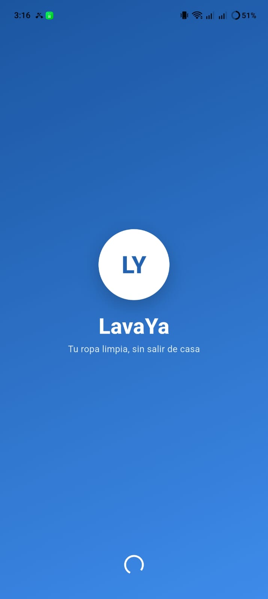

### Autenticación
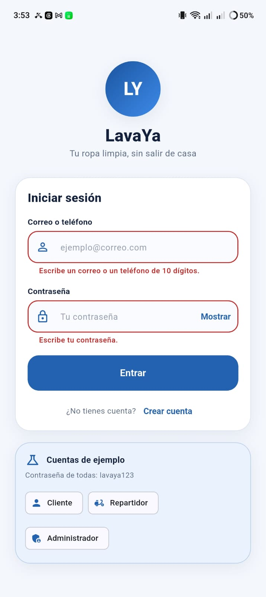
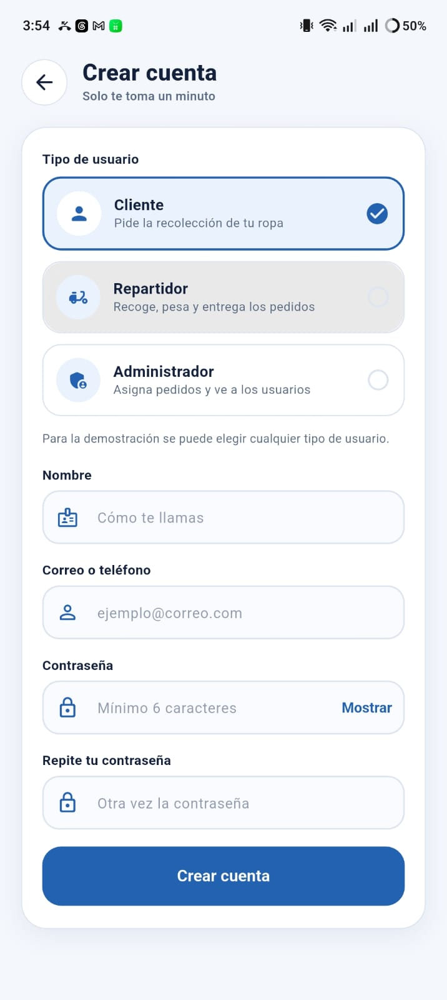

### Dashboards
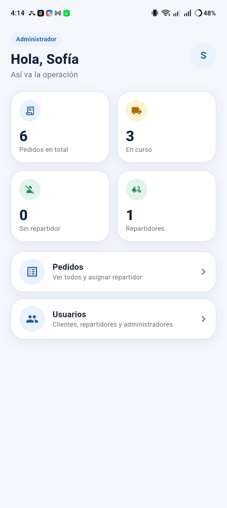
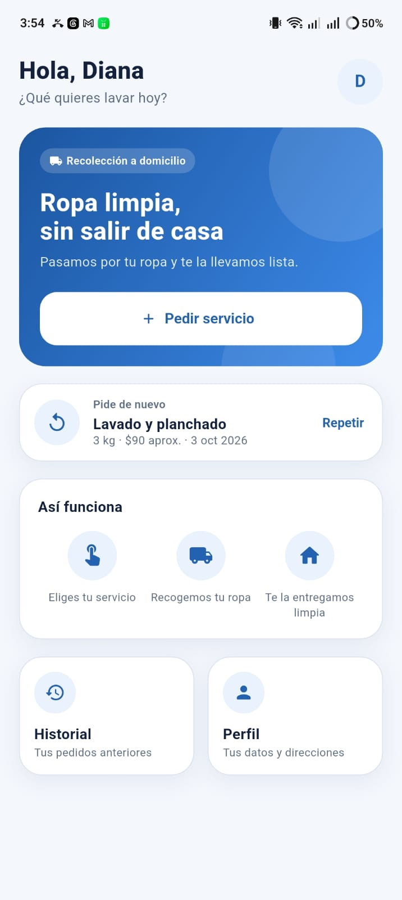
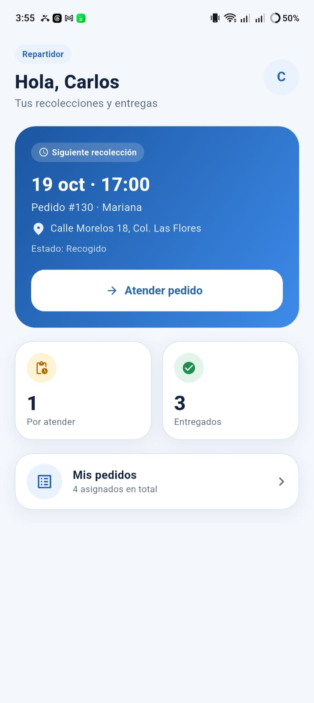

### Listas
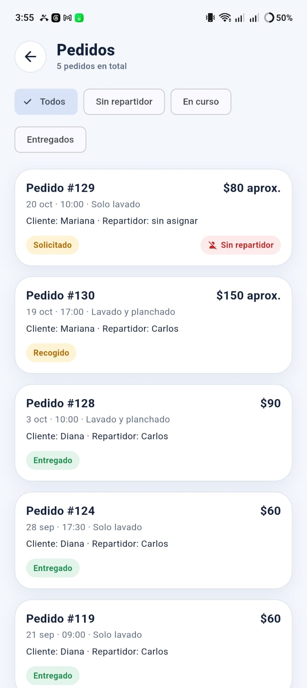
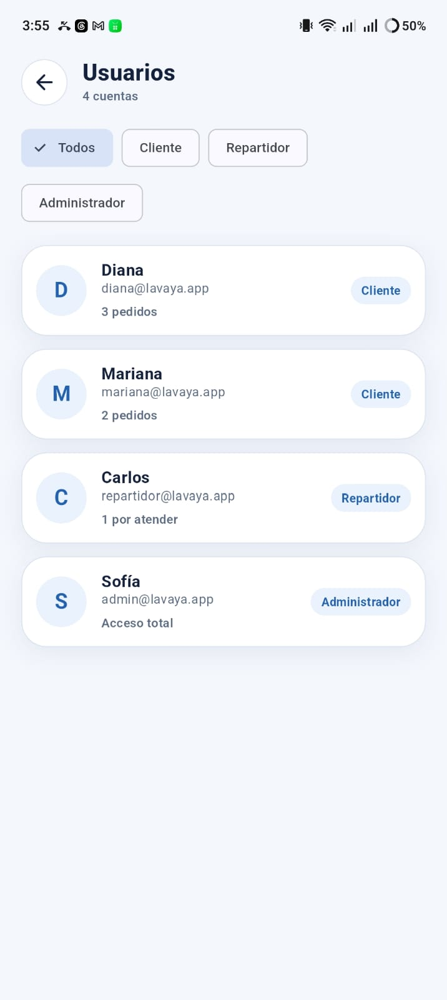
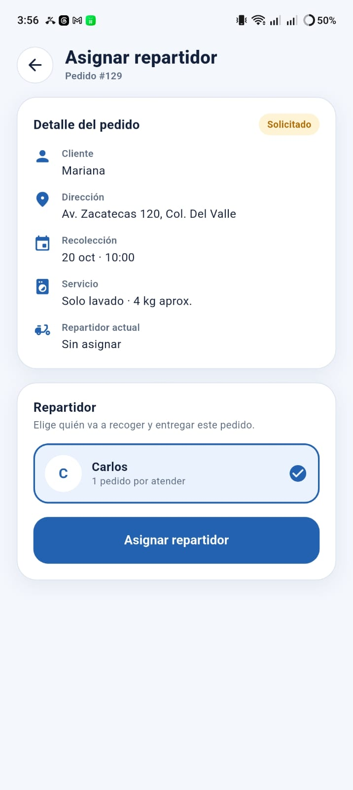

### Formularios
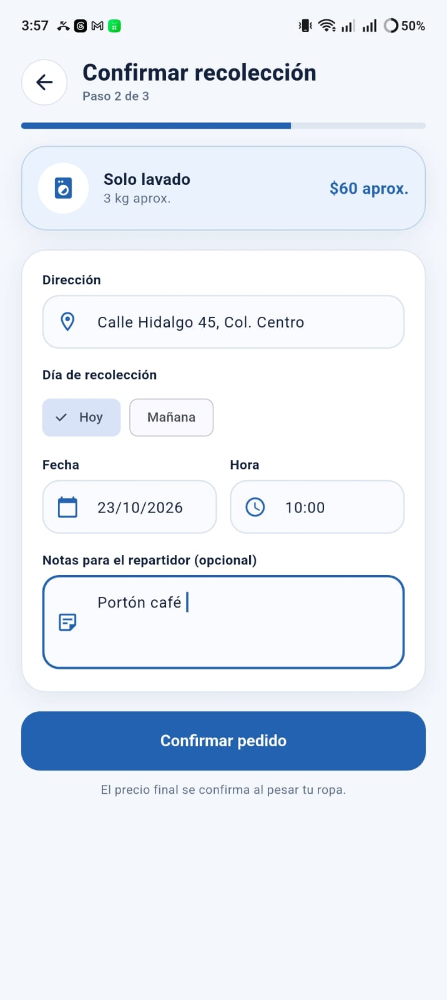

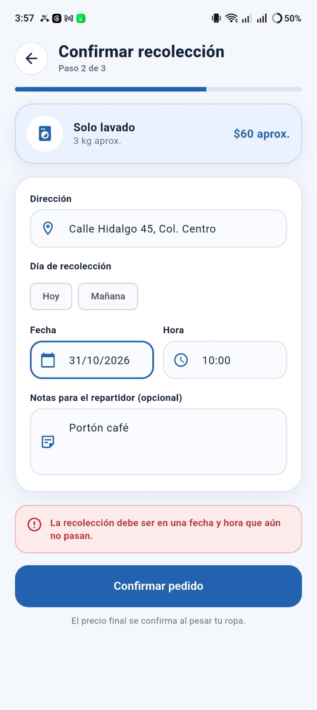

### Evidencia funcional
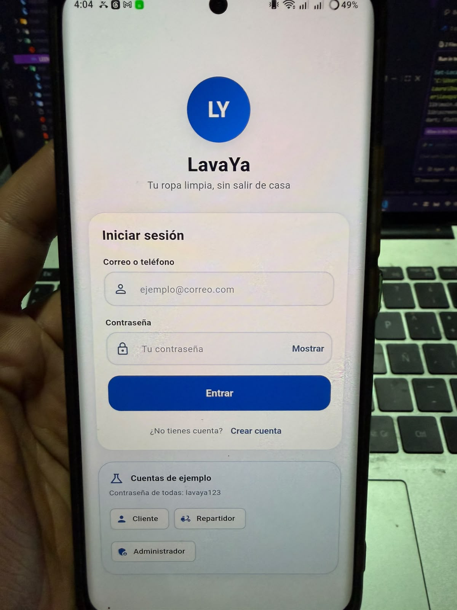


## 7. Estructura del proyecto y patrones de diseño

```
lib/
├── core/                     utilidades: ids, reloj, fechas, formato, hash de contraseña
├── domain/                   reglas del negocio (Dart puro, sin Flutter)
│   ├── entities/             Usuario, Servicio, Pedido
│   ├── value_objects/        Dinero, Contacto, RolUsuario, TipoServicio y EstadoPedido
│   ├── builders/             PedidoBuilder                  (patrón Builder)
│   ├── repositories/         LavaYaRepository (interfaz)    (patrón Repository)
│   └── services/             CatalogoService (puerto)
├── screens/                  splash, login, registro y las pantallas de cada tipo de usuario
├── data/                     implementaciones
│   ├── memoria_lavaya_repository.dart   en memoria (sirve para pruebas)
│   ├── local_lavaya_repository.dart     guarda en el dispositivo (SharedPreferences)
│   ├── datos_demo.dart                  cuentas y pedidos de ejemplo
│   └── adapters/             CatalogoLocalAdapter           (patrón Adapter)
└── presentation/
    ├── app_state.dart        ChangeNotifier                 (patrón Observer)
    ├── app_scope.dart        entrega el estado a las pantallas
    ├── tema.dart             colores, sombras y degradado
    └── widgets/              componentes compartidos y el mapa de seguimiento
```

| Patrón | Familia | Capa | Archivo |
|---|---|---|---|
| Builder | Creacional | Lógica de negocio | `domain/builders/pedido_builder.dart` (también es el borrador del pedido) |
| Adapter | Estructural | Datos | `data/adapters/catalogo_local_adapter.dart` (implementa `CatalogoService`) |
| Observer | Comportamiento | Lógica de negocio y Presentación | `presentation/app_state.dart` (`ChangeNotifier`) |
| Repository | Emergente | Datos | `domain/repositories/` + `data/*_lavaya_repository.dart` |

## 8. Decisiones y límites

- **Precios por kilo** de ejemplo: $20 (solo lavado) y $30 (lavado y planchado). Los tiempos estimados por etapa también son de ejemplo.
- **El mapa** está dibujado dentro de la app (sin Google Maps); la ruta es de ejemplo, no de una ciudad real.
- **"Avanzar etapa (demo)"** en el seguimiento del cliente simula el avance; en el flujo real lo hace el repartidor.
- **Cualquiera puede elegir cualquier tipo de usuario al registrarse**, porque la actividad lo pide. En una app real el rol de
  repartidor o administrador lo asignaría un administrador desde el servidor.
- Los datos viven en el dispositivo: no hay servidor, pagos ni notificaciones reales.
- La contraseña se guarda como hash SHA-256 sin sal (suficiente para la demostración; en producción va en un servidor).
